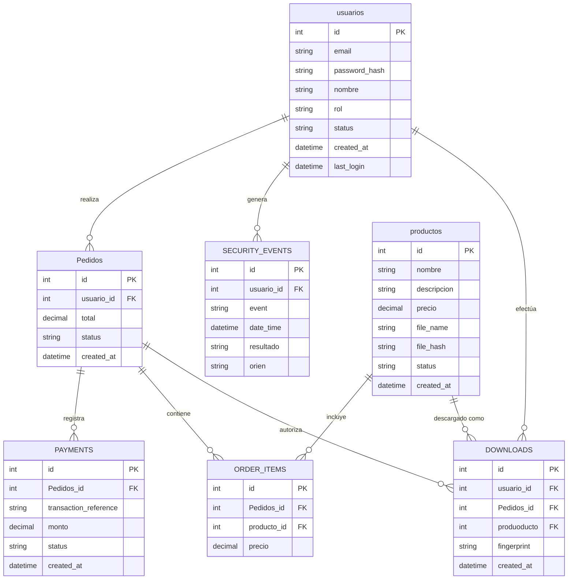

# Diagrama Entidad-Relación (ERD)

## Tablas y Atributos

### `usuarios`

| Tipo     | Nombre        | Llave |
| :------- | :------------ | :---- |
| int      | id            | PK    |
| string   | email         |       |
| string   | password_hash |       |
| string   | nombre        |       |
| string   | rol           |       |
| string   | status        |       |
| datetime | created_at    |       |
| datetime | last_login    |       |

### `Pedidos`

| Tipo     | Nombre     | Llave |
| :------- | :--------- | :---- |
| int      | id         | PK    |
| int      | usuario_id | FK    |
| decimal  | total      |       |
| string   | status     |       |
| datetime | created_at |       |

### `SECURITY_EVENTS`

| Tipo     | Nombre     | Llave |
| :------- | :--------- | :---- |
| int      | id         | PK    |
| int      | usuario_id | FK    |
| string   | event      |       |
| datetime | date_time  |       |
| string   | resultado  |       |
| string   | orien      |       |

### `productos`

| Tipo     | Nombre      | Llave |
| :------- | :---------- | :---- |
| int      | id          | PK    |
| string   | nombre      |       |
| string   | descripcion |       |
| decimal  | precio      |       |
| string   | file_name   |       |
| string   | file_hash   |       |
| string   | status      |       |
| datetime | created_at  |       |

### `PAYMENTS`

| Tipo     | Nombre                | Llave |
| :------- | :-------------------- | :---- |
| int      | id                    | PK    |
| int      | Pedidos_id            | FK    |
| string   | transaction_reference |       |
| decimal  | monto                 |       |
| string   | status                |       |
| datetime | created_at            |       |

### `ORDER_ITEMS`

| Tipo    | Nombre      | Llave |
| :------ | :---------- | :---- |
| int     | id          | PK    |
| int     | Pedidos_id  | FK    |
| int     | producto_id | FK    |
| decimal | precio      |       |

### `DOWNLOADS`

| Tipo     | Nombre      | Llave |
| :------- | :---------- | :---- |
| int      | id          | PK    |
| int      | usuario_id  | FK    |
| int      | Pedidos_id  | FK    |
| int      | produoducto | FK    |
| string   | fingerprint |       |
| datetime | created_at  |       |

---

## Relaciones

Las líneas del diagrama indican las siguientes relaciones de uno a muchos (1:N):

* **usuarios** `realiza` **Pedidos**
* **usuarios** `genera` **SECURITY_EVENTS**
* **usuarios** `efectúa` **DOWNLOADS**
* **Pedidos** `registra` **PAYMENTS**
* **Pedidos** `contiene` **ORDER_ITEMS**
* **Pedidos** `autoriza` **DOWNLOADS**
* **productos** `incluye` **ORDER_ITEMS**
* **productos** `descargado como` **DOWNLOADS**

---

